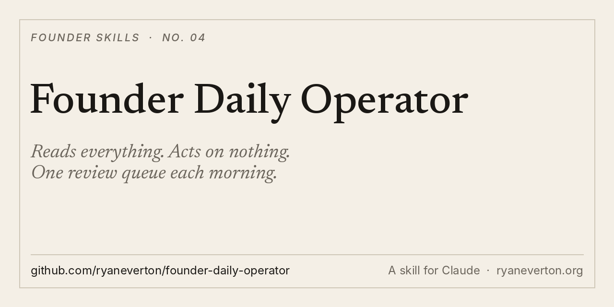

<p align="center"></p>

# Founder Daily Operator

**A read-only morning operator for founders running several companies with agents.**

It reads every project, flags what changed overnight, re-ranks your tasks by leverage, and hands you a review queue built to clear in under 10 minutes. It never sends, spends, deploys or deletes. It escalates.

[Install](#install) · [What it makes](#what-it-makes) · [Guardrails](#guardrails) · [Set it up](#set-it-up) · [Why I built it](#why-i-built-it)

## What it makes

Every morning, in your ops folder:

- **`TODAY_REVIEW_QUEUE.md`.** What ran overnight, decisions you owe, money approvals, drafts to approve, blockers needing your login, the highest-leverage next action per project.
- **`MASTER_CURRENT_STATE.md`.** One line per project: status, what changed, the blocker.
- **`MASTER_TASK_QUEUE.md`.** Re-ranked by leverage: revenue, then whatever unblocks other people, then deadlines.
- **`MASTER_APPROVAL_QUEUE.md`.** True escalations only.
- **A 4 to 6 line summary** sent to you, and only you, if you configure a channel.

## Guardrails

Written into the skill. It may never:

- message anyone except you
- spend money or place orders
- deploy sites or change live pricing
- delete or move files
- make legal or production commitments

Anything that needs one of those lands in your queue instead.

## Install

**Claude Code**

```
/plugin marketplace add ryaneverton/founder-daily-operator
/plugin install founder-daily-operator@founder-daily-operator
```

**Any agent (Cursor, Codex, Gemini CLI and more)**

```
npx skills add ryaneverton/founder-daily-operator
```

**Claude app (web and desktop)**

1. Download [founder-daily-operator.zip](https://github.com/ryaneverton/founder-daily-operator/raw/main/dist/founder-daily-operator.zip)
2. In Claude, open **Customize › Skills**, click **+**, then **Create skill › Upload a skill**
3. Upload the ZIP

**Manual**

```
git clone https://github.com/ryaneverton/founder-daily-operator
cp -r founder-daily-operator/skills/founder-daily-operator ~/.claude/skills/
```

## Set it up

1. Run it once: "Set up my ops folder with the founder daily operator." It scaffolds the files from templates and asks for your project list.
2. Point your overnight agents at `projects/<name>/reports/`.
3. Schedule it every weekday morning, after the overnight runs finish. Or just ask: "What needs me today?"

## Why I built it

I run several companies at once, with agents working overnight: supplier follow-ups, site QA, the daily standup. The risk isn't that agents do too little. It's that they act without approval, or bury you in output.

This operator fixes both. It reads everything, writes only its own five files, and gives me one queue each morning. Every send, spend, deploy or delete gets escalated, never executed.

## Pairs with

- [leverage-playbook](https://github.com/ryaneverton/leverage-playbook): who makes the business big
- [gtm-execution-playbook](https://github.com/ryaneverton/gtm-execution-playbook): how to sell it week to week
- [pilot-to-scale-gtm](https://github.com/ryaneverton/pilot-to-scale-gtm): turn pilots into contracts, and contracts into expansion

## About

Built by [Ryan Everton](https://ryaneverton.org). I write [The Intuitive Founder](https://ryaneverton.substack.com), on pragmatic AI and the inner work of building something real.

If this helped, star the repo and tell me what your agents run overnight: [@ryandeverton](https://x.com/ryandeverton).

MIT License.
